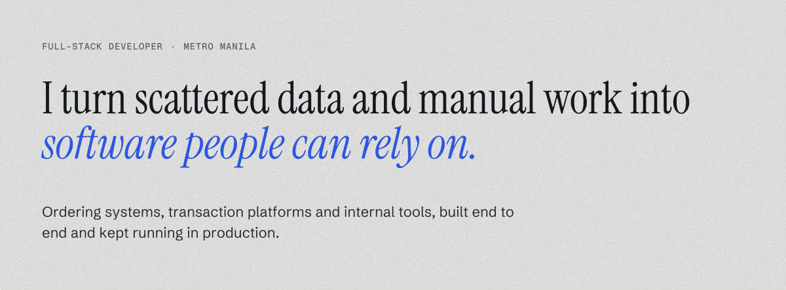
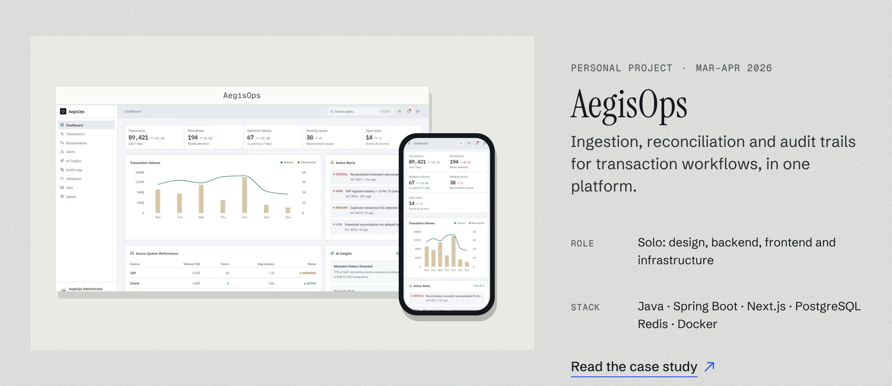
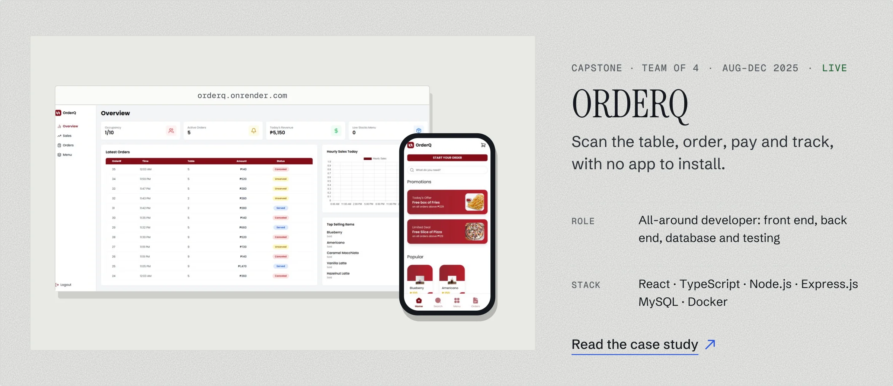
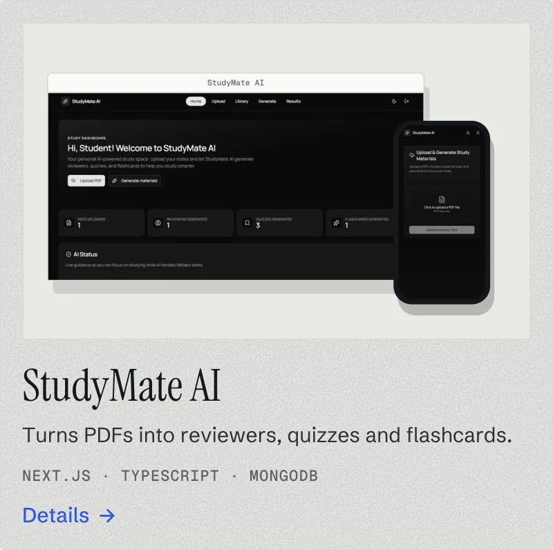
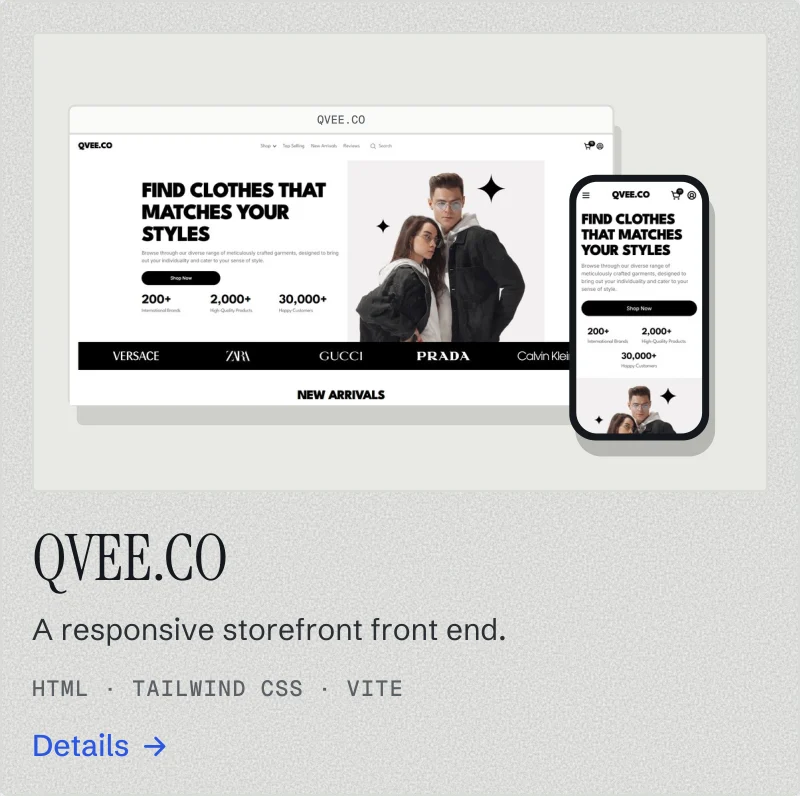
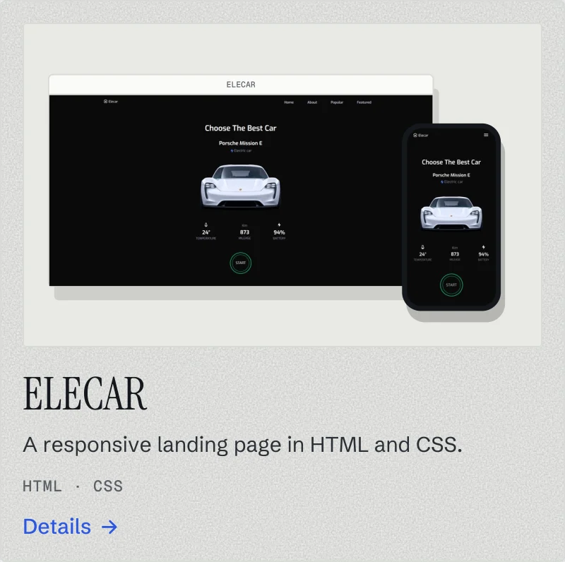
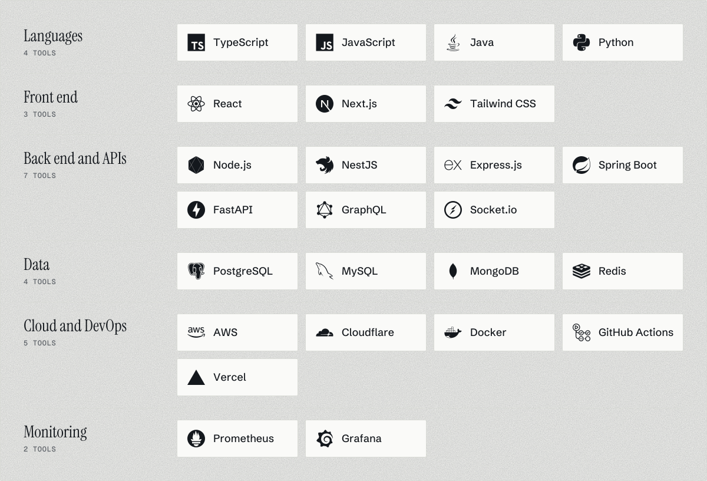
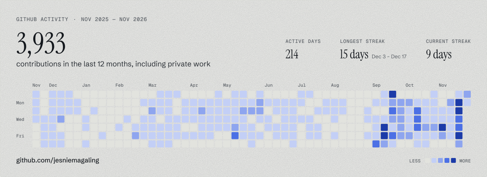

<a href="https://www.jesniemagaling.me">
  <picture>
    <source media="(prefers-color-scheme: dark)" srcset="assets/banner-dark.svg">
    
  </picture>
</a>

  <a href="https://www.jesniemagaling.me"><b>Portfolio</b></a> &nbsp;·&nbsp;
  <a href="https://res.cloudinary.com/lebhdn7m/raw/upload/v1793082903/portfolio/uploads/docs/86c36d87-414c-45c5-a746-0dac7eeca2d1.pdf"><b>Résumé</b></a> &nbsp;·&nbsp;
  <a href="https://linkedin.com/in/jesniemagaling"><b>LinkedIn</b></a> &nbsp;·&nbsp;
  <a href="mailto:magalingjesnie@gmail.com"><b>Email</b></a>

## Selected work

<a href="https://www.jesniemagaling.me/projects/aegisops">
  <picture>
    <source media="(prefers-color-scheme: dark)" srcset="assets/case-aegisops-dark.webp">
    
  </picture>
</a>

<a href="https://www.jesniemagaling.me/projects/orderq">
  <picture>
    <source media="(prefers-color-scheme: dark)" srcset="assets/case-orderq-dark.webp">
    
  </picture>
</a>

### More work

  <a href="https://www.jesniemagaling.me/projects/studymate-ai"><picture><source media="(prefers-color-scheme: dark)" srcset="assets/work-studymate-ai-dark.webp"></picture></a>
  <a href="https://www.jesniemagaling.me/projects/ecommerce"><picture><source media="(prefers-color-scheme: dark)" srcset="assets/work-ecommerce-dark.webp"></picture></a>
  <a href="https://www.jesniemagaling.me/projects/chat-app"><picture><source media="(prefers-color-scheme: dark)" srcset="assets/work-chat-app-dark.webp"></picture></a>

## Stack

What I build with, front end to back end.

<picture>
  <source media="(prefers-color-scheme: dark)" srcset="assets/stack-dark.svg">
  
</picture>

## Activity

<picture>
  <source media="(prefers-color-scheme: dark)" srcset="assets/activity-dark.svg">
  
</picture>

---

Full-stack developer in Metro Manila · BS Information Technology, cum laude, 2026 · <a href="https://www.jesniemagaling.me">jesniemagaling.me</a>
